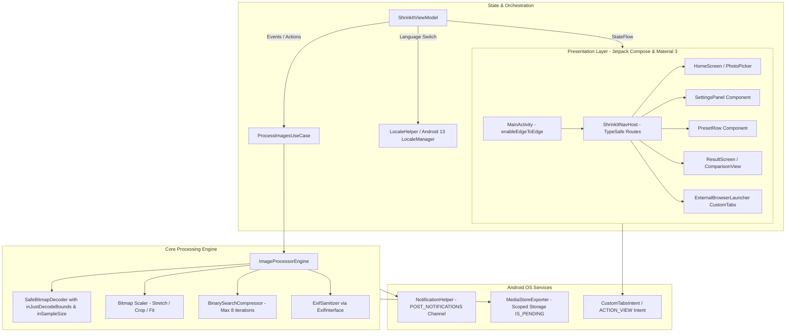

# Technical Requirements Document (TRD) — ShrinkIt Android

> **Reference Engine:** [ShrinkIt Web Engine](file:///d:/0/1/shrinkit/src/lib/image/engine.ts)  
> **App Package / Namespace:** `com.dusrel.shrinkit`  
> **Status:** Approved for Implementation  
> **Tech Stack:** Kotlin 2.0.21+, Jetpack Compose Material 3, Coroutines, Coil 3, Hilt, ExifInterface, AndroidX Custom Tabs

---

## 1. System Architecture & Component Diagram



---

## 2. Technical Stack & Version Catalog (`gradle/libs.versions.toml`)

```toml
[versions]
agp = "8.8.2"
kotlin = "2.0.21"
coreKtx = "1.15.0"
lifecycleRuntimeKtx = "2.8.7"
activityCompose = "1.9.3"
composeBom = "2024.12.01"
material3 = "1.3.1"
navigationCompose = "2.8.5"
hilt = "2.52"
hiltNavigationCompose = "1.3.0"
coil3 = "3.0.4"
exifinterface = "1.3.7"
browser = "1.8.0"
coroutines = "1.9.0"
junit = "4.13.2"
junitVersion = "1.2.1"
espressoCore = "3.6.1"

[libraries]
androidx-core-ktx = { group = "androidx.core", name = "core-ktx", version.ref = "coreKtx" }
androidx-lifecycle-runtime-ktx = { group = "androidx.lifecycle", name = "lifecycle-runtime-ktx", version.ref = "lifecycleRuntimeKtx" }
androidx-activity-compose = { group = "androidx.activity", name = "activity-compose", version.ref = "activityCompose" }
androidx-compose-bom = { group = "androidx.compose", name = "compose-bom", version.ref = "composeBom" }
androidx-ui = { group = "androidx.compose.ui", name = "ui" }
androidx-ui-graphics = { group = "androidx.compose.ui", name = "ui-graphics" }
androidx-ui-tooling = { group = "androidx.compose.ui", name = "ui-tooling" }
androidx-ui-tooling-preview = { group = "androidx.compose.ui", name = "ui-tooling-preview" }
androidx-material3 = { group = "androidx.compose.material3", name = "material3", version.ref = "material3" }
androidx-material-icons-extended = { group = "androidx.compose.material", name = "material-icons-extended" }
androidx-navigation-compose = { group = "androidx.navigation", name = "navigation-compose", version.ref = "navigationCompose" }
androidx-browser = { group = "androidx.browser", name = "browser", version.ref = "browser" }
androidx-exifinterface = { group = "androidx.exifinterface", name = "exifinterface", version.ref = "exifinterface" }
coil3-compose = { group = "io.coil-kt.coil3", name = "coil-compose", version.ref = "coil3" }
hilt-android = { group = "com.google.dagger", name = "hilt-android", version.ref = "hilt" }
hilt-compiler = { group = "com.google.dagger", name = "hilt-android-compiler", version.ref = "hilt" }
androidx-hilt-navigation-compose = { group = "androidx.hilt", name = "hilt-navigation-compose", version.ref = "hiltNavigationCompose" }
kotlinx-coroutines-android = { group = "org.jetbrains.kotlinx", name = "kotlinx-coroutines-android", version.ref = "coroutines" }

[plugins]
android-application = { id = "com.android.application", version.ref = "agp" }
kotlin-android = { id = "org.jetbrains.kotlin.android", version.ref = "kotlin" }
compose-compiler = { id = "org.jetbrains.kotlin.plugin.compose", version.ref = "kotlin" }
hilt-android = { id = "com.google.dagger.hilt.android", version.ref = "hilt" }
kotlin-serialization = { id = "org.jetbrains.kotlin.plugin.serialization", version.ref = "kotlin" }
```

---

## 3. Core Architectural Patterns & Critical Day 1 Invariants

### 3.1. Android 15 Edge-to-Edge Mandatory Handling
In `MainActivity.kt`:
```kotlin
override fun onCreate(savedInstanceState: Bundle?) {
    super.onCreate(savedInstanceState)
    enableEdgeToEdge()
    setContent {
        ShrinkItTheme {
            Scaffold(
                modifier = Modifier
                    .fillMaxSize()
                    .safeDrawingPadding()
            ) { innerPadding ->
                ShrinkItNavHost(modifier = Modifier.padding(innerPadding))
            }
        }
    }
}
```

### 3.2. OutOfMemory (OOM) Protection: Safe Bitmap Decoding
Prevents memory exhaustion on 50MP–108MP phone camera photos:
```kotlin
fun decodeSampledBitmapFromUri(
    context: Context,
    uri: Uri,
    reqWidth: Int,
    reqHeight: Int
): Bitmap? {
    val options = BitmapFactory.Options().apply { inJustDecodeBounds = true }
    context.contentResolver.openInputStream(uri)?.use {
        BitmapFactory.decodeStream(it, null, options)
    }

    options.inSampleSize = calculateInSampleSize(options, reqWidth, reqHeight)
    options.inJustDecodeBounds = false
    options.inPreferredConfig = Bitmap.Config.ARGB_8888

    return context.contentResolver.openInputStream(uri)?.use {
        BitmapFactory.decodeStream(it, null, options)
    }
}
```

### 3.3. Scoped Storage Atomic Writes (`IS_PENDING` Flag)
Guarantees zero corrupted/half-written images in the user's gallery:
```kotlin
suspend fun saveToGallery(context: Context, bytes: ByteArray, mimeType: String, fileName: String): Uri? = withContext(Dispatchers.IO) {
    val contentValues = ContentValues().apply {
        put(MediaStore.MediaColumns.DISPLAY_NAME, fileName)
        put(MediaStore.MediaColumns.MIME_TYPE, mimeType)
        put(MediaStore.MediaColumns.RELATIVE_PATH, "Pictures/ShrinkIt")
        if (Build.VERSION.SDK_INT >= Build.VERSION_CODES.Q) {
            put(MediaStore.MediaColumns.IS_PENDING, 1) // Mark as pending
        }
    }

    val resolver = context.contentResolver
    val uri = resolver.insert(MediaStore.Images.Media.EXTERNAL_CONTENT_URI, contentValues) ?: return@withContext null

    resolver.openOutputStream(uri)?.use { stream ->
        stream.write(bytes)
        stream.flush()
    }

    if (Build.VERSION.SDK_INT >= Build.VERSION_CODES.Q) {
        contentValues.clear()
        contentValues.put(MediaStore.MediaColumns.IS_PENDING, 0) // Flip to ready
        resolver.update(uri, contentValues, null, null)
    }
    uri
}
```

### 3.4. Multi-Language Resource Directories & Locales Config
`res/xml/locales_config.xml`:
```xml
<?xml version="1.0" encoding="utf-8"?>
<locale-config xmlns:android="http://schemas.android.com/apk/res/android">
    <locale android:name="en"/>
    <locale android:name="hi"/>
    <locale android:name="as"/>
</locale-config>
```
Registered in `AndroidManifest.xml` via `android:localeConfig="@xml/locales_config"`.

---

## 4. UI Theme & Design Tokens Parity ([global.css](file:///d:/0/1/shrinkit/src/styles/global.css))

```kotlin
object ShrinkItColors {
    val BrandBlue = Color(0xFF007BFF)
    val BrandBlueDark = Color(0xFF0257BF)
    val AccentTeal = Color(0xFF42C3AC)
    val InkLight = Color(0xFF1D2939)
    val MutedLight = Color(0xFF667085)
    val SurfaceLight = Color(0xFFFFFFFF)
    val SurfaceBandLight = Color(0xFFFAFCFF)
    val BorderLight = Color(0xFFE2E8F0)
    
    // Graphite Dark
    val SurfaceDark = Color(0xFF121417)
    val SurfaceCardDark = Color(0xFF1E2228)
    val InkDark = Color(0xFFF1F5F9)
    val MutedDark = Color(0xFF94A3B8)
    val BorderDark = Color(0xFF2E353F)
}
```
