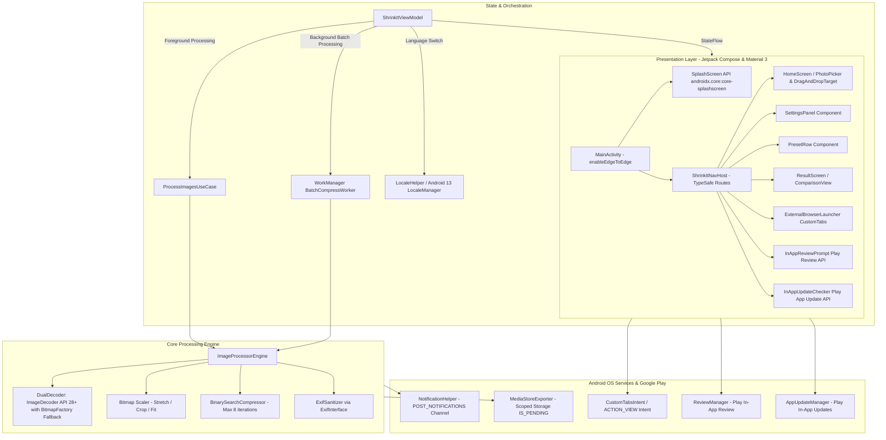

# Technical Requirements Document (TRD) — ShrinkIt Android

> **Reference Engine:** [ShrinkIt Web Engine](file:///d:/0/1/shrinkit/src/lib/image/engine.ts)  
> **App Package / Namespace:** `com.dusrel.shrinkit`  
> **Status:** Approved for Implementation  
> **Tech Stack:** Kotlin 2.0.21+, Jetpack Compose Material 3, WorkManager, ImageDecoder, Coil 3, Hilt 2.52, Play Review, Play App Update

---

## 1. System Architecture & Component Diagram



---

## 2. Technical Stack & Version Catalog (`gradle/libs.versions.toml`)

```toml
[versions]
agp = "8.8.2"
kotlin = "2.0.21"
coreKtx = "1.15.0"
coreSplashscreen = "1.2.0"
lifecycleRuntimeKtx = "2.8.7"
activityCompose = "1.9.3"
composeBom = "2024.12.01"
material3 = "1.3.1"
navigationCompose = "2.8.5"
hilt = "2.52"
hiltNavigationCompose = "1.3.0"
workManager = "2.10.0"
coil3 = "3.0.4"
exifinterface = "1.3.7"
browser = "1.8.0"
playReview = "2.0.2"
playAppUpdate = "2.1.0"
coroutines = "1.9.0"
junit = "4.13.2"
junitVersion = "1.2.1"
espressoCore = "3.6.1"

[libraries]
androidx-core-ktx = { group = "androidx.core", name = "core-ktx", version.ref = "coreKtx" }
androidx-core-splashscreen = { group = "androidx.core", name = "core-splashscreen", version.ref = "coreSplashscreen" }
androidx-lifecycle-runtime-ktx = { group = "androidx.lifecycle", name = "lifecycle-runtime-ktx", version.ref = "lifecycleRuntimeKtx" }
androidx-activity-compose = { group = "androidx.activity", name = "activity-compose", version.ref = "activityCompose" }
androidx-compose-bom = { group = "androidx.compose", name = "compose-bom", version.ref = "composeBom" }
androidx-ui = { group = "androidx.compose.ui", name = "ui" }
androidx-ui-graphics = { group = "androidx.compose.ui", name = "ui-graphics" }
androidx-ui-tooling = { group = "androidx.compose.ui", name = "ui-tooling" }
androidx-ui-tooling-preview = { group = "androidx.compose.ui", name = "ui-tooling-preview" }
androidx-material3 = { group = "androidx.compose.material3", name = "material3", version.ref = "material3" }
androidx-material-icons-extended = { group = "androidx.compose.material", name = "material-icons-extended" }
androidx-navigation-compose = { group = "androidx.navigation", name = "navigation-compose", version.ref = "navigationCompose" }
androidx-work-runtime-ktx = { group = "androidx.work", name = "work-runtime-ktx", version.ref = "workManager" }
androidx-browser = { group = "androidx.browser", name = "browser", version.ref = "browser" }
androidx-exifinterface = { group = "androidx.exifinterface", name = "exifinterface", version.ref = "exifinterface" }
coil3-compose = { group = "io.coil-kt.coil3", name = "coil-compose", version.ref = "coil3" }
hilt-android = { group = "com.google.dagger", name = "hilt-android", version.ref = "hilt" }
hilt-compiler = { group = "com.google.dagger", name = "hilt-android-compiler", version.ref = "hilt" }
androidx-hilt-navigation-compose = { group = "androidx.hilt", name = "hilt-navigation-compose", version.ref = "hiltNavigationCompose" }
play-review-ktx = { group = "com.google.android.play", name = "review-ktx", version.ref = "playReview" }
play-app-update-ktx = { group = "com.google.android.play", name = "app-update-ktx", version.ref = "playAppUpdate" }
kotlinx-coroutines-android = { group = "org.jetbrains.kotlinx", name = "kotlinx-coroutines-android", version.ref = "coroutines" }

[plugins]
android-application = { id = "com.android.application", version.ref = "agp" }
kotlin-android = { id = "org.jetbrains.kotlin.android", version.ref = "kotlin" }
compose-compiler = { id = "org.jetbrains.kotlin.plugin.compose", version.ref = "kotlin" }
hilt-android = { id = "com.google.dagger.hilt.android", version.ref = "hilt" }
kotlin-serialization = { id = "org.jetbrains.kotlin.plugin.serialization", version.ref = "kotlin" }
```

---

## 3. Image Decoding Strategy: ImageDecoder + BitmapFactory Dual Engine

### The Problem with BitmapFactory Alone:
Modern phone cameras (Samsung, Pixel, iPhone) default to **HEIC / HEIF** and **AVIF**. `BitmapFactory` returns `null` or fails to decode them on many Android devices and ignores EXIF orientation.

### Dual Engine Solution:
```kotlin
object SafeBitmapDecoder {
    fun decode(context: Context, uri: Uri, maxSide: Int = 4096): Bitmap? {
        // API 28+ (Android 9 to 15): Native ImageDecoder handles HEIC, AVIF, WebP, JPEG and auto-rotates EXIF
        if (Build.VERSION.SDK_INT >= Build.VERSION_CODES.P) {
            return try {
                val source = ImageDecoder.createSource(context.contentResolver, uri)
                ImageDecoder.decodeBitmap(source) { decoder, info, _ ->
                    // Set downsampling to prevent OOM
                    val origMax = maxOf(info.size.width, info.size.height)
                    if (origMax > maxSide) {
                        decoder.setTargetSampleSize(calculateSampleSize(origMax, maxSide))
                    }
                    decoder.allocator = ImageDecoder.ALLOCATOR_SOFTWARE // Allow Canvas mutation
                }
            } catch (e: Exception) {
                // Fallback to BitmapFactory if ImageDecoder throws
                decodeWithBitmapFactory(context, uri, maxSide)
            }
        }
        // API 24–27 (Android 7.0–8.1): BitmapFactory with inJustDecodeBounds
        return decodeWithBitmapFactory(context, uri, maxSide)
    }

    private fun decodeWithBitmapFactory(context: Context, uri: Uri, maxSide: Int): Bitmap? {
        val options = BitmapFactory.Options().apply { inJustDecodeBounds = true }
        context.contentResolver.openInputStream(uri)?.use { BitmapFactory.decodeStream(it, null, options) }
        val origMax = maxOf(options.outWidth, options.outHeight)
        options.inSampleSize = calculateSampleSize(origMax, maxSide)
        options.inJustDecodeBounds = false
        options.inPreferredConfig = Bitmap.Config.ARGB_8888
        return context.contentResolver.openInputStream(uri)?.use { BitmapFactory.decodeStream(it, null, options) }
    }

    private fun calculateSampleSize(origMax: Int, maxSide: Int): Int {
        var sampleSize = 1
        while (origMax / (sampleSize * 2) >= maxSide) {
            sampleSize *= 2
        }
        return sampleSize
    }
}
```

---

## 4. Background Resilience: WorkManager (`androidx.work:work-runtime-ktx`)

For batch processing (10–50+ images), relying strictly on ViewModel coroutines causes termination if the user locks their device or switches to another app.

**WorkManager Integration:**
- `BatchCompressWorker : CoroutineWorker`
- Uses `setForeground(createForegroundInfo())` for ongoing progress notifications.
- Guarantees batch completion even across system low-memory pressure.

---

## 5. Google Play Store 2026 Compliance Checklist

1. **Target SDK Policy:** `targetSdk = 35` (Android 15) strictly satisfies Google Play's mandatory target API level timeline.
2. **16 KB Memory Page Size Support:** Pure Kotlin/Java runtime with 100% AndroidX and Google Play dependencies (zero native C/C++ `.so` files). Fully 16 KB page-size safe out of the box with zero ELF alignment issues.
3. **Data Safety Form Pre-Fill:**
   - *Does your app collect or share any user data?* $\to$ **NO**.
   - *Is all user data processed ephemerally?* $\to$ **YES** (Bitmaps discarded after save).
   - *Privacy Policy URL:* `https://shrinkit.dusrel.com/privacy`
4. **Closed Testing Track Requirement:**
   - For Personal Accounts created after Nov 13, 2023: Minimum **12 testers opted-in for 14 continuous days** before Production access.
   - For Organization Accounts (DUNS verified): Direct production release.
5. **Release Build Artifact:**
   - Android App Bundle (`.aab`) generated with `./gradlew bundleRelease`.
   - ProGuard/R8 minification and resource shrinking enabled (`isMinifyEnabled = true`, `isShrinkResources = true`).
6. **In-App Review & Update:**
   - Play In-App Review prompts after 5 successful compression jobs.
   - Play In-App Update checks for flexible updates on startup.
