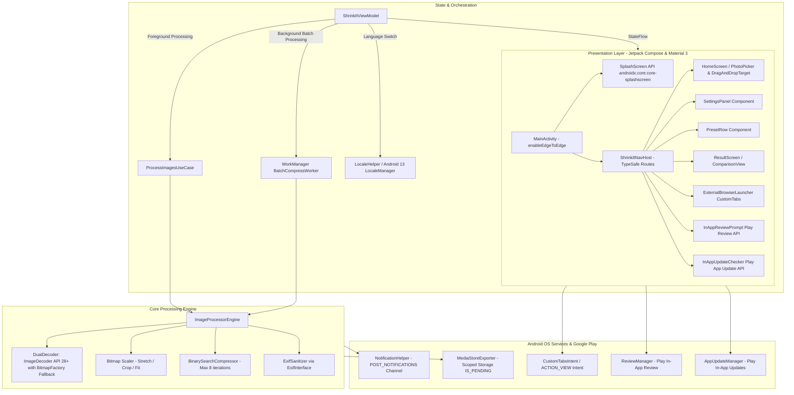

# Technical Requirements Document (TRD) — ShrinkIt Android

> **Reference Engine:** [ShrinkIt Web Engine](https://shrinkit.dusrel.com)  
> **App Package / Namespace:** `com.dusrel.shrinkit`  
> **Status:** Approved for Implementation  
> **Tech Stack:** Kotlin 2.4.x+, Jetpack Compose Material 3, KSP, WorkManager 2.12.0, ImageDecoder, Coil 3, Hilt 2.60+, Play Review, Play App Update

---

## 1. System Architecture & Component Diagram



---

## 2. Technical Stack & Version Catalog (`gradle/libs.versions.toml`)

```toml
[versions]
agp = "9.4.0"
kotlin = "2.4.10"
ksp = "2.3.10"
coreKtx = "1.19.1"
coreSplashscreen = "1.2.0"
lifecycleRuntimeKtx = "2.10.0"
activityCompose = "1.9.3"
composeBom = "2026.09.00"
navigationCompose = "2.10.2"
hilt = "2.60.1"
hiltNavigationCompose = "1.3.0"
workManager = "2.12.0"
coil3 = "3.6.3"
exifinterface = "1.3.7"
browser = "1.8.0"
playReview = "2.0.2"
playAppUpdate = "2.1.0"
coroutines = "1.11.0"
junit = "4.13.2"
junitVersion = "1.2.1"
espressoCore = "3.6.1"

[libraries]
androidx-core-ktx = { group = "androidx.core", name = "core-ktx", version.ref = "coreKtx" }
androidx-core-splashscreen = { group = "androidx.core", name = "core-splashscreen", version.ref = "coreSplashscreen" }
androidx-lifecycle-runtime-ktx = { group = "androidx.lifecycle", name = "lifecycle-runtime-ktx", version.ref = "lifecycleRuntimeKtx" }
androidx-activity-compose = { group = "androidx.activity", name = "activity-compose", version.ref = "activityCompose" }
androidx-compose-bom = { group = "androidx.compose", name = "compose-bom", version.ref = "composeBom" }
androidx-ui = { group = "androidx.compose.ui", name = "ui" }
androidx-ui-graphics = { group = "androidx.compose.ui", name = "ui-graphics" }
androidx-ui-tooling = { group = "androidx.compose.ui", name = "ui-tooling" }
androidx-ui-tooling-preview = { group = "androidx.compose.ui", name = "ui-tooling-preview" }
# Material3 managed by Compose BOM - zero version override to prevent binary mismatch
androidx-material3 = { group = "androidx.compose.material3", name = "material3" }
androidx-material-icons-extended = { group = "androidx.compose.material", name = "material-icons-extended" }
androidx-navigation-compose = { group = "androidx.navigation", name = "navigation-compose", version.ref = "navigationCompose" }
androidx-work-runtime-ktx = { group = "androidx.work", name = "work-runtime-ktx", version.ref = "workManager" }
androidx-browser = { group = "androidx.browser", name = "browser", version.ref = "browser" }
androidx-exifinterface = { group = "androidx.exifinterface", name = "exifinterface", version.ref = "exifinterface" }
coil3-compose = { group = "io.coil-kt.coil3", name = "coil-compose", version.ref = "coil3" }
hilt-android = { group = "com.google.dagger", name = "hilt-android", version.ref = "hilt" }
hilt-compiler = { group = "com.google.dagger", name = "hilt-compiler", version.ref = "hilt" }
androidx-hilt-navigation-compose = { group = "androidx.hilt", name = "hilt-navigation-compose", version.ref = "hiltNavigationCompose" }
play-review-ktx = { group = "com.google.android.play", name = "review-ktx", version.ref = "playReview" }
play-app-update-ktx = { group = "com.google.android.play", name = "app-update-ktx", version.ref = "playAppUpdate" }
kotlinx-coroutines-android = { group = "org.jetbrains.kotlinx", name = "kotlinx-coroutines-android", version.ref = "coroutines" }

[plugins]
android-application = { id = "com.android.application", version.ref = "agp" }
kotlin-android = { id = "org.jetbrains.kotlin.android", version.ref = "kotlin" }
compose-compiler = { id = "org.jetbrains.kotlin.plugin.compose", version.ref = "kotlin" }
ksp = { id = "com.google.devtools.ksp", version.ref = "ksp" }
hilt-android = { id = "com.google.dagger.hilt.android", version.ref = "hilt" }
kotlin-serialization = { id = "org.jetbrains.kotlin.plugin.serialization", version.ref = "kotlin" }
```

### Compiler Configuration Pattern in `app/build.gradle.kts`:
```kotlin
plugins {
    alias(libs.plugins.android.application)
    alias(libs.plugins.kotlin.android)
    alias(libs.plugins.compose.compiler)
    alias(libs.plugins.ksp)
    alias(libs.plugins.hilt.android)
    alias(libs.plugins.kotlin.serialization)
}

dependencies {
    // Dagger Hilt Code Generation via KSP (replacing legacy KAPT)
    ksp(libs.hilt.compiler)
    implementation(libs.hilt.android)
    implementation(libs.androidx.hilt.navigation.compose)
    ...
}
```

---

## 3. Image Decoding Strategy: ImageDecoder + BitmapFactory Dual Engine

### Codec Availability & Device Checks:
- **JPEG / PNG / WebP:** Universally supported across all API 24–36 devices.
- **HEIC / HEIF:** Native support in API 28+, but device hardware/software codec licensing varies. The engine verifies `ImageDecoder.isMimeTypeSupported("image/heif")` and catches `DecodeException`.
- **AVIF:** Introduced natively in **Android 12 (API 31+)**. On API 28–30, AVIF cannot be decoded natively by `ImageDecoder` or `BitmapFactory`.

```kotlin
object SafeBitmapDecoder {
    fun decode(context: Context, uri: Uri, maxSide: Int = 4096): Bitmap? {
        val resolver = context.contentResolver
        val mimeType = resolver.getType(uri) ?: ""

        // Guard against AVIF on unsupported API levels (< 31)
        if (mimeType == "image/avif" && Build.VERSION.SDK_INT < Build.VERSION_CODES.S) {
            return null // Refuse unsupported codec gracefully without crash
        }

        // API 28+ (Android 9 to 16): Native ImageDecoder
        if (Build.VERSION.SDK_INT >= Build.VERSION_CODES.P) {
            // Guard for device-optional HEIF codec
            if (mimeType == "image/heif" || mimeType == "image/heic") {
                if (!ImageDecoder.isMimeTypeSupported("image/heif")) {
                    return decodeWithBitmapFactory(context, uri, maxSide)
                }
            }

            return try {
                val source = ImageDecoder.createSource(resolver, uri)
                ImageDecoder.decodeBitmap(source) { decoder, info, _ ->
                    val origMax = maxOf(info.size.width, info.size.height)
                    if (origMax > maxSide) {
                        decoder.setTargetSampleSize(calculateSampleSize(origMax, maxSide))
                    }
                    decoder.allocator = ImageDecoder.ALLOCATOR_SOFTWARE
                }
            } catch (e: Exception) {
                decodeWithBitmapFactory(context, uri, maxSide)
            }
        }

        // Fallback for API 24–27
        return decodeWithBitmapFactory(context, uri, maxSide)
    }

    private fun decodeWithBitmapFactory(context: Context, uri: Uri, maxSide: Int): Bitmap? {
        val options = BitmapFactory.Options().apply { inJustDecodeBounds = true }
        context.contentResolver.openInputStream(uri)?.use { BitmapFactory.decodeStream(it, null, options) }
        val origMax = maxOf(options.outWidth, options.outHeight)
        if (origMax <= 0) return null // Corrupted / unreadable stream
        options.inSampleSize = calculateSampleSize(origMax, maxSide)
        options.inJustDecodeBounds = false
        options.inPreferredConfig = Bitmap.Config.ARGB_8888
        return context.contentResolver.openInputStream(uri)?.use { BitmapFactory.decodeStream(it, null, options) }
    }

    private fun calculateSampleSize(origMax: Int, maxSide: Int): Int {
        var sampleSize = 1
        while (origMax / (sampleSize * 2) >= maxSide) {
            sampleSize *= 2
        }
        return sampleSize
    }
}
```

---

## 4. Background Processing: WorkManager & Foreground Service Configuration

For batch processing, WorkManager provides resilient, best-effort background execution.

### Android 14+ (API 34+) Foreground Service Declaration:
In `AndroidManifest.xml`:
```xml
<uses-permission android:name="android.permission.FOREGROUND_SERVICE" />
<uses-permission android:name="android.permission.FOREGROUND_SERVICE_DATA_SYNC" />

<service
    android:name="androidx.work.impl.foreground.SystemForegroundService"
    android:foregroundServiceType="dataSync"
    tools:node="merge" />
```

Inside `BatchCompressWorker : CoroutineWorker`:
```kotlin
override suspend fun doWork(): Result = withContext(Dispatchers.Default) {
    if (Build.VERSION.SDK_INT >= Build.VERSION_CODES.Q) {
        setForeground(createForegroundInfo(progress = 0, total = inputUris.size))
    }
    // Process images sequentially...
    Result.success()
}
```

---

## 5. Google Play Store Compliance & Publishing Checklist

1. **Target SDK Policy:** `compileSdk = 36` and `targetSdk = 36` (Android 16), strictly satisfying Google Play's mandatory August 31, 2026 requirement.
2. **16 KB Memory Page Size Support:** Pure Kotlin/Java runtime with 100% AndroidX dependencies (zero native C/C++ `.so` files). Verified inherently 16 KB-safe. (Enforcement date on Google Play: February 1, 2027).
3. **Data Safety Form Pre-Fill:**
   - *Does your app collect or share any user data?* $\to$ **NO**.
   - *Is all user data processed ephemerally?* $\to$ **YES**.
   - *Privacy Policy URL:* `https://shrinkit.dusrel.com/privacy`
4. **Closed Testing Track Requirement:**
   - For Personal Accounts created after Nov 13, 2023: Minimum **12 testers opted-in for 14 continuous days** before Production access.
   - For Organization Accounts (DUNS verified): Direct production release.
5. **Release Build Artifact:**
   - Android App Bundle (`.aab`) generated with `./gradlew bundleRelease`.
   - ProGuard/R8 minification and resource shrinking enabled (`isMinifyEnabled = true`, `isShrinkResources = true`).
6. **In-App Review & Update:**
   - Play In-App Review prompts after 5 successful compression jobs.
   - Play In-App Update checks for flexible updates on startup.
